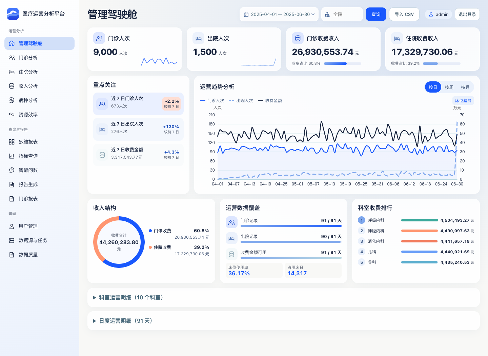

# 医疗运营数据主题分析平台

使用课程数据展示门诊、住院、收入、病种和资源效率。管理驾驶舱支持日期与科室筛选。多维报表可导出 Excel，综合运营周报和月报可导出 PDF。

## 页面预览



- [门诊分析](docs/screenshots/02-outpatient.png)
- [收入分析](docs/screenshots/03-revenue.png)
- [资源效率](docs/screenshots/04-resource.png)
- [多维报表](docs/screenshots/05-multidimensional-report.png)
- [综合运营月报](docs/screenshots/06-operations-report.png)

## 启动方式

- [Docker 冒烟](deploy/README.md)使用合成门诊数据，启动四个容器并验证网关、`/health` 和门诊聚合接口。
- 完整驾驶舱、报表、问数与管理功能使用下文的课程数据库和登录账号。

## 安装依赖

在项目根目录执行。需要 Python 3.11 或以上、Node.js 22.12 或以上。完整运行使用 MySQL 8.4。

```sh
python3 -m venv .venv
.venv/bin/python -m pip install -r backend/requirements.txt
(cd frontend && npm ci)
```

## 初始化课程数据

1. 在课程平台「数据材料」下载数据集，按[数据目录说明](data/README.md)放置六份 CSV。
2. 在独立 MySQL 中创建空库 `hospital` 和该库的专用账号。实例须监听 `127.0.0.1:13306`。在同一个终端配置 `ODS_DATABASE_URL`，格式为 `mysql://账号:密码@127.0.0.1:13306/hospital`。账号或密码中的 URL 特殊字符需编码。连接串和密钥保存在本机私有配置中。
3. 生成本次环境的脱敏密钥和 JWT 密钥。已构建的批次须继续使用原脱敏密钥与标识。

```sh
umask 077
mkdir -p .runtime
test -f .runtime/dwd-privacy-key || .venv/bin/python -c 'import base64,secrets; print(base64.b64encode(secrets.token_bytes(32)).decode())' > .runtime/dwd-privacy-key
test -f .runtime/jwt-secret || .venv/bin/python -c 'import secrets; print(secrets.token_urlsafe(48))' > .runtime/jwt-secret
export DWD_PRIVACY_KEY="$(cat .runtime/dwd-privacy-key)" DWD_PRIVACY_KEY_ID=course-local-v1
export AUTH_ENABLED=1 PYTHONPATH=backend
export OUTPATIENT_PREVIEW_DATASET_ID=course-platform-v1
export OUTPATIENT_PREVIEW_BATCH_DATE=2025-06-30 OUTPATIENT_PREVIEW_ENV=dev
```

4. 建表并登记课程批次。

```sh
.venv/bin/python - <<'PY'
from os import environ
from pathlib import Path

from etl.config.source_config import COURSE_DATASET, SOURCES, connect_database, register_source
from etl.jobs import build_dims, build_dwd, clean_dwd, extract_ods

extract_ods.initialize_schema()
clean_dwd.initialize_schema()
build_dims.initialize_dim_schema()
build_dwd.initialize_schema()
with connect_database() as connection, connection.cursor() as cursor:
    schemas = [
        Path("sql/auth/auth_tables.sql"),
        *sorted(p for p in Path("sql/auth").glob("*.sql") if p.name != "auth_tables.sql"),
        Path("sql/dws/dws_tables.sql"),
        *sorted(Path("sql/ads").glob("*.sql")),
    ]
    for schema in schemas:
        for statement in schema.read_text(encoding="utf-8").split(";"):
            if statement.strip():
                cursor.execute(statement)
    connection.commit()
for name, spec in SOURCES.items():
    register_source(name, {
        "kind": "csv",
        "file_path": str(Path("data") / spec["path"]),
        "dataset_id": COURSE_DATASET,
        "etl_batch_date": environ["OUTPATIENT_PREVIEW_BATCH_DATE"],
    })
PY
```

5. 跑采集、清洗、质检及宽表构建。看到 `ETL_OK` 后，按实际覆盖区间发布八主题集市，并导出当前构建号供 API 使用。

```sh
.venv/bin/python -m etl.jobs.run_all --env dev --through dwd
OUTPATIENT_PREVIEW_BUILD_RUN_ID=$(.venv/bin/python - <<'PY'
from os import environ

from etl.config.source_config import COURSE_DATASET, connect_database
from etl.jobs.backfill import backfill

batch = environ["OUTPATIENT_PREVIEW_BATCH_DATE"]
with connect_database() as connection, connection.cursor() as cursor:
    cursor.execute(
        "SELECT build_run_id, effective_start, effective_end FROM dwd_build_audit "
        "WHERE dataset_id=%s AND batch_date=%s", (COURSE_DATASET, batch),
    )
    run_id, first, last = cursor.fetchone()
result = backfill(first.isoformat(), last.isoformat(), dataset_id=COURSE_DATASET, batch_date=batch)
if result["status"] != "PASS":
    raise SystemExit("集市发布失败")
print(run_id)
PY
)
export OUTPATIENT_PREVIEW_BUILD_RUN_ID
```

6. 创建管理员，根据终端提示输入至少 12 字节的密码。后端沿用上面终端中的配置。

```sh
.venv/bin/python -m app.core.auth_store admin
.venv/bin/python -m uvicorn app.main:app --host 127.0.0.1 --port 8765
```

在另一个终端启动前端。

```sh
cd frontend
npm run dev
```

打开 [本地网页](http://127.0.0.1:5173)，用刚创建的账号登录。

## 测试

新解压的目录先生成合成测试样例。

```sh
.venv/bin/python scripts/data/generate_mock.py --months 12
PYTHONPATH=backend .venv/bin/python -m pytest backend/tests tests
(cd frontend && npm test && npm run lint && npm run build)
```

MySQL 集成测试需单独配置 `ODS_TEST_DATABASE_URL`，指向隔离的 `hospital_test`。
